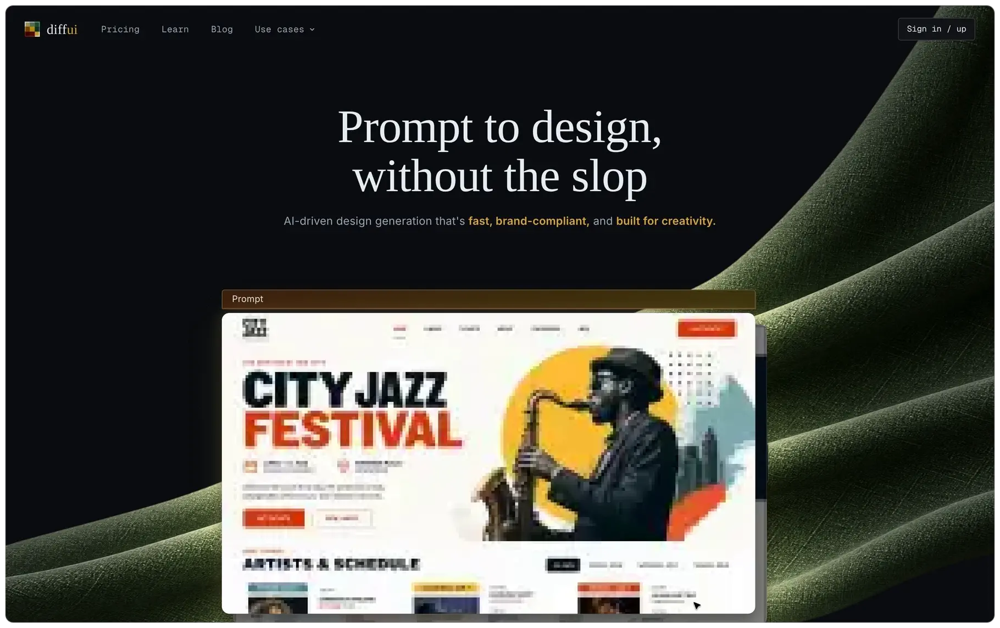
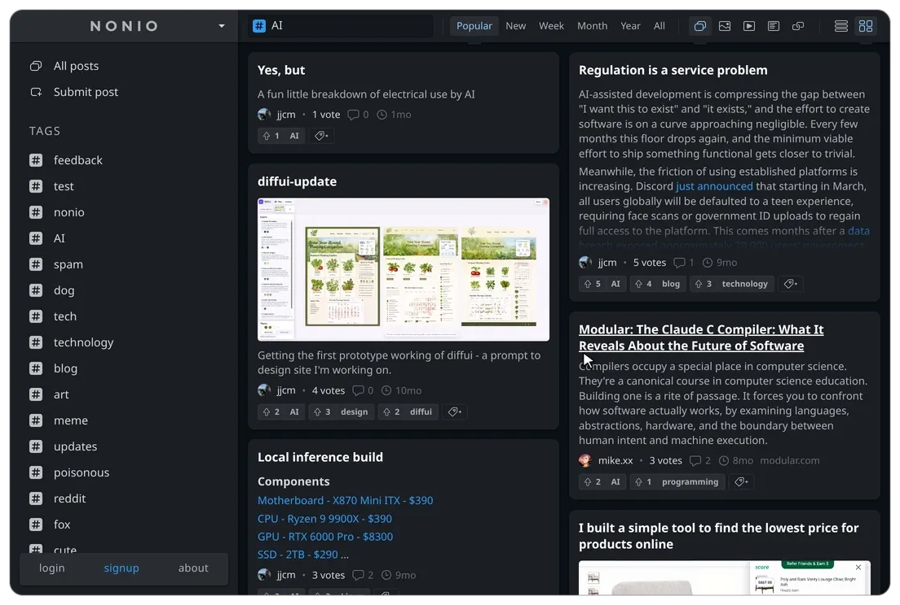
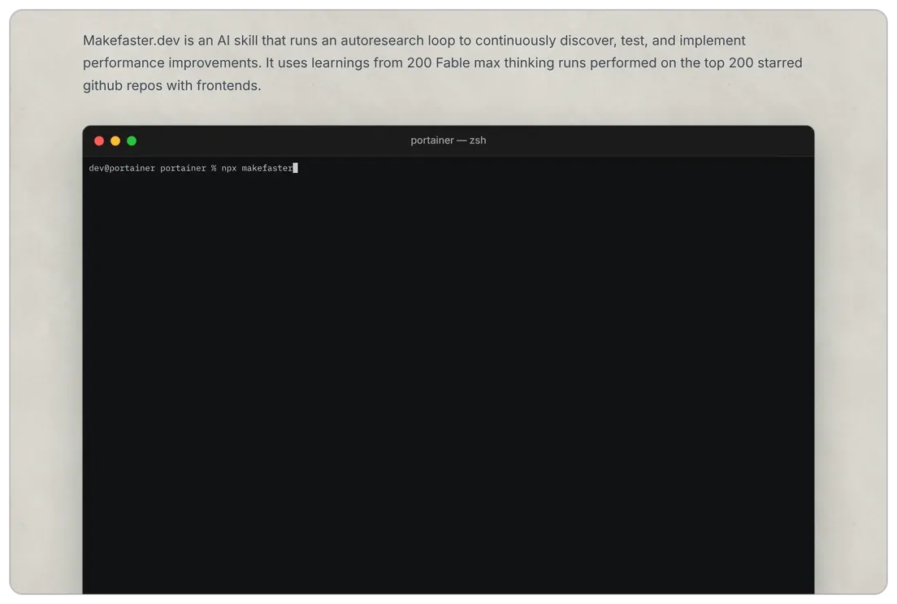
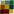
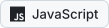
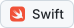
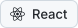

<table>
  <tr>
    <td>
      
      <a href="https://jjcm.org"><picture><source media="(prefers-color-scheme: dark)" srcset="profile/icons/dark/globe.svg"></picture></a>
      <a href="https://x.com/pwnies"><picture><source media="(prefers-color-scheme: dark)" srcset="profile/icons/dark/x.svg"></picture></a>
      <b>Hi, I'm Jacob.</b> I do art and code and sometimes other things.
    </td>
  </tr>
  <tr>
    <td>
      <a href="https://diffui.ai"><picture><source media="(prefers-reduced-motion: reduce)" srcset="profile/diffui-still.webp"></picture></a> 
      <a href="https://non.io"><picture><source media="(prefers-reduced-motion: reduce)" srcset="profile/nonio-still.webp"></picture></a><a href="https://makefaster.dev"><picture><source media="(prefers-reduced-motion: reduce)" srcset="profile/makefaster-still.webp"></picture></a>
    </td>
  </tr>
  <tr>
    <td>
      &nbsp; <a href="https://diffui.ai"><b>DiffUI</b></a> &nbsp;AI design canvas. Prompt in, on-brand UI out. Becoming <a href="https://linen.ai">Linen</a> on Nov 23. 
      &nbsp; <a href="https://non.io"><b>Nonio</b></a> &nbsp;Ad-free community site. Your subscription gets split between the posts you upvote. 
      <picture><source media="(prefers-color-scheme: dark)" srcset="profile/icons/brand/makefaster-dark.svg"></picture>&nbsp; <a href="https://makefaster.dev"><b>makefaster</b></a> &nbsp;Point an agent at your site and it keeps finding speed wins. Plus a public leaderboard.
    </td>
  </tr>
  <tr>
    <td>
      <b>languages</b> 
      <picture><source media="(prefers-color-scheme: dark)" srcset="profile/badges/dark/typescript.svg"></picture>
      <picture><source media="(prefers-color-scheme: dark)" srcset="profile/badges/dark/javascript.svg"></picture>
      <picture><source media="(prefers-color-scheme: dark)" srcset="profile/badges/dark/go.svg"></picture>
      <picture><source media="(prefers-color-scheme: dark)" srcset="profile/badges/dark/swift.svg"></picture>
      <picture><source media="(prefers-color-scheme: dark)" srcset="profile/badges/dark/python.svg"></picture>
      <picture><source media="(prefers-color-scheme: dark)" srcset="profile/badges/dark/html.svg"></picture>
      <picture><source media="(prefers-color-scheme: dark)" srcset="profile/badges/dark/css.svg"></picture>
    </td>
  </tr>
  <tr>
    <td>
      <b>frontend</b> 
      <picture><source media="(prefers-color-scheme: dark)" srcset="profile/badges/dark/web-components.svg"></picture>
      <picture><source media="(prefers-color-scheme: dark)" srcset="profile/badges/dark/react.svg"></picture>
      <picture><source media="(prefers-color-scheme: dark)" srcset="profile/badges/dark/tailwind.svg"></picture>
      <picture><source media="(prefers-color-scheme: dark)" srcset="profile/badges/dark/vite.svg"></picture>
      <picture><source media="(prefers-color-scheme: dark)" srcset="profile/badges/dark/electron.svg"></picture>
      <picture><source media="(prefers-color-scheme: dark)" srcset="profile/badges/dark/pug.svg"></picture>
      <picture><source media="(prefers-color-scheme: dark)" srcset="profile/badges/dark/stylus.svg"></picture>
    </td>
  </tr>
  <tr>
    <td>
      <b>backend / infra</b> 
      <picture><source media="(prefers-color-scheme: dark)" srcset="profile/badges/dark/node-js.svg"></picture>
      <picture><source media="(prefers-color-scheme: dark)" srcset="profile/badges/dark/hono.svg"></picture>
      <picture><source media="(prefers-color-scheme: dark)" srcset="profile/badges/dark/mariadb.svg"></picture>
      <picture><source media="(prefers-color-scheme: dark)" srcset="profile/badges/dark/sqlite.svg"></picture>
      <picture><source media="(prefers-color-scheme: dark)" srcset="profile/badges/dark/drizzle.svg"></picture>
      <picture><source media="(prefers-color-scheme: dark)" srcset="profile/badges/dark/docker.svg"></picture>
      <picture><source media="(prefers-color-scheme: dark)" srcset="profile/badges/dark/ffmpeg.svg"></picture>
    </td>
  </tr>
  <tr>
    <td>
      <b>agents / tooling</b> 
      <picture><source media="(prefers-color-scheme: dark)" srcset="profile/badges/dark/claude-code.svg"></picture>
      <picture><source media="(prefers-color-scheme: dark)" srcset="profile/badges/dark/codex.svg"></picture>
      <picture><source media="(prefers-color-scheme: dark)" srcset="profile/badges/dark/cursor.svg"></picture>
      <picture><source media="(prefers-color-scheme: dark)" srcset="profile/badges/dark/mcp.svg"></picture>
      <picture><source media="(prefers-color-scheme: dark)" srcset="profile/badges/dark/lighthouse.svg"></picture>
    </td>
  </tr>
</table>
